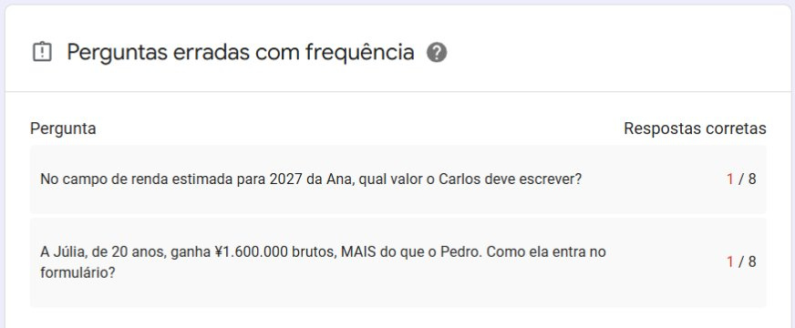
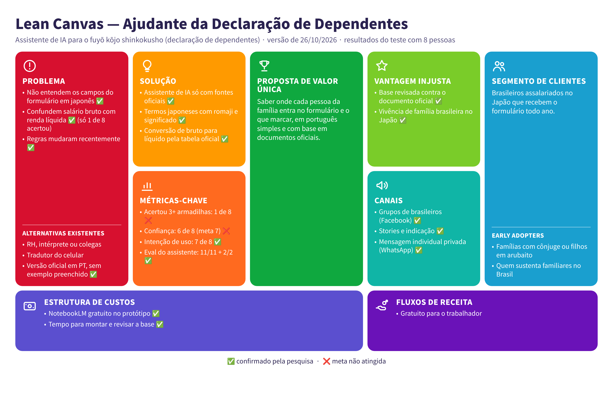

# Da Hipótese à Evidência — Ajudante das Declarações de Fim de Ano

Case de Product Discovery da disciplina **Metodologias Ágeis e Validação de Produtos** (UniFECAF, IA e Automação Digital, 2º semestre). Aluna: Paloma Ai Tsuchinaga · Outubro de 2026

> **Resumo:** testei se um assistente de IA, baseado em documentos oficiais, ajuda brasileiros no Japão a preencher a declaração de dependentes. O problema se confirmou e as pessoas disseram que usariam o assistente, mas só 1 de 8 acertou as armadilhas do formulário. **Decisão: ajustar.**

## 🔗 Acesso rápido

| O quê | Link | Para quê |
|---|---|---|
| 🎥 Vídeo pitch | [Assistir no YouTube](https://youtu.be/8c1KtLUDgbE) | O projeto em até 4 minutos |
| 🤖 Assistente v2 — Nenmatsu Kokuzei Amigo | [Abrir no NotebookLM](https://notebook.google.com/notebook/ff5c43fc-adbe-49bc-aff0-a0a67c94022c) | Versão ajustada depois do teste |
| 🤖 Assistente v1 | [Abrir no NotebookLM](https://notebook.google.com/notebook/fb38933d-f2a2-484e-ad90-f479220349fd) | Versão testada com as 8 pessoas |
| 📝 Questionário | [Google Forms (encerrado)](https://docs.google.com/forms/d/e/1FAIpQLSdWkEzgEcBtztzTXN6StSxFSbEX4bHaYuxx9MwAe4zaqydfBw/viewform?usp=header) | O experimento |
| 📄 Exemplo oficial 2027 | [Kokuzeichō (PDF)](https://www.nta.go.jp/publication/pamph/gensen/nencho2026/pdf/309.pdf) | Fonte principal do assistente |
| 🇧🇷 Declaração 2027 em português | [Kokuzeichō (PDF)](https://www.nta.go.jp/taxes/tetsuzuki/shinsei/annai/gensen/pdf/r09_01_po.pdf) | Versão oficial traduzida |

## 1. Problema

Todo fim de ano, quem trabalha como assalariado no Japão recebe da empresa o 給与所得者の扶養控除等(異動)申告書 (*fuyō kōjo shinkokusho*), a declaração de dependentes. O formulário é em japonês, usa conceitos técnicos (como a diferença entre salário bruto e renda líquida) e as regras mudaram recentemente.

**Público:** brasileiros assalariados no Japão, principalmente famílias com cônjuge ou filhos que fazem *arubaito* e quem sustenta familiares no Brasil.

**Oportunidade:** a Agência Nacional de Impostos do Japão (Kokuzeichō) publica uma versão em português, mas sem exemplo preenchido e com trechos de tradução confusos.

## 2. Hipóteses

| Tipo | Hipótese |
|---|---|
| Problema (H1) | Brasileiros no Japão têm dificuldade com a declaração de dependentes: adiam a entrega, pedem ajuda ou preenchem errado |
| Solução (H2) | Com um assistente de IA baseado nas fontes oficiais, uma pessoa leiga consegue preencher corretamente os campos mais difíceis |
| Valor (H3) | As pessoas usariam o assistente quando recebessem o formulário de verdade |

## 3. MVP

Em vez de desenvolver um app, o MVP foi um assistente no **NotebookLM**, que responde só com base nas fontes carregadas:
- exemplo oficial de preenchimento de 2027 (記載例, *kisairei*) da Kokuzeichō;
- base de conhecimento com 25 cenários de famílias brasileiras, glossário com romaji e tabelas de conversão de bruto para líquido;
- instrução com 10 regras (responder só pelas fontes, nunca inventar valores, recusar temas fora do escopo).

Antes de ir para as pessoas, o assistente passou por um **eval** de 13 perguntas: rodada 1 = 10/11 + 2/2; rodada 2 = 11/11 + 2/2 (o erro da rodada 1 foi um valor de renda líquida inventado, corrigido na instrução).

🔗 [Assistente v1 (NotebookLM)](https://notebook.google.com/notebook/fb38933d-f2a2-484e-ad90-f479220349fd)

## 4. Experimento

- **Formato:** Google Forms anônimo, em modo teste, cerca de 12 minutos, sem entrevista.
- **Parte 1:** perguntas sobre a experiência real com o formulário no ano anterior.
- **Parte 2:** a pessoa usou o assistente para responder 4 perguntas sobre uma família fictícia. Cada pessoa da família representava uma armadilha:
  - Lucas, 6 anos → vai na seção do imposto residencial, não na parte B
  - Ana, esposa com arubaito de ¥1.690.000 → o formulário pede a renda líquida (¥950.000), não o bruto
  - Pedro, 17 anos, ¥1.500.000 → passou do limite, não entra
  - Júlia, 20 anos, ¥1.600.000 → entra como 特定親族 (*tokutei shinzoku*), mesmo ganhando mais que o irmão
- **Parte 3:** tempo, confiança e intenção de uso.
- **Recrutamento:** grupos de brasileiros no Facebook, stories, mensagens individuais no WhatsApp e indicações (21 a 26/10/2026).
- **Critérios de sucesso e regra de decisão:** registrados em 21/10/2026, antes da publicação do questionário. Como vieram 8 respostas em vez de 5, a régua foi ajustada pela mesma proporção e registrada em 26/10, antes da análise.

### A Família Fictícia

Para ninguém precisar expor dados da própria família, todas as pessoas responderam a Parte 2 sobre a mesma família inventada. O texto abaixo foi mostrado no questionário exatamente assim.

> **🧑🏻 SEU PERSONAGEM FICTÍCIO**
> Você é o Carlos, brasileiro, 40 anos, mora no Japão e trabalha numa fábrica. A empresa entregou a declaração de dependentes de 2027. Sua família mora toda com você no Japão. Os valores abaixo são a estimativa de salário bruto (antes dos descontos) de cada um para 2027.
>
> - **Carlos (você):** 40 anos. Salário bruto de ¥4.200.000
> - **Ana (esposa):** 38 anos. Trabalha meio período (*arubaito*). Salário bruto de ¥1.690.000
> - **Júlia (filha):** nascida em março de 2007, tem 20 anos. Faz *arubaito*. Salário bruto de ¥1.600.000
> - **Pedro (filho):** nascido em maio de 2010, tem 17 anos. Faz *arubaito*. Salário bruto de ¥1.500.000
> - **Lucas (filho):** nascido em 2021, tem 6 anos. Não trabalha
>
> Ninguém da família tem deficiência, outra renda além do salário ou outro emprego.

## 5. Evidências e resultados (8 respostas)

| Hipótese | Critério | Resultado | Passou? |
|---|---|---|---|
| Problema | 5 de 8 adiaram +1 semana, pediram ajuda ou tiveram correção | **5 de 8** | ✅ (no limite) |
| Solução | 7 de 8 acertam 3+ das 4 armadilhas em até 15 min | **1 de 8** | ❌ |
| Confiança | 7 de 8 dão nota 4 ou 5 | **6 de 8** | ❌ |
| Valor | 5 de 8 responderiam "Sim, com certeza" | **7 de 8** | ✅ |
| Segurança | Eval: no máximo 1 erro em 11 e as 2 recusas certas | **11/11 + 2/2** | ✅ |

### Acertos por armadilha
| Armadilha | Acertos | Resposta errada mais comum |
|---|---|---|
| Lucas (menor de 16 anos) | 5 de 8 | "Parte B, junto com os irmãos" (2) |
| Ana (bruto × líquido) | **1 de 8** | Escreveu o valor bruto ¥1.690.000 (4) |
| Pedro (passou do limite) | 6 de 8 | — |
| Júlia (tokutei shinzoku) | **1 de 8** | "Não entra, passou do limite" (4) |

### Outros dados
- **8 de 8** não sabiam que existe a versão oficial em português.
- **5 de 8** responderam o quiz em menos de 5 minutos.
- **6 de 8** deram nota 4 ou 5 de confiança, mas só 1 acertou 3 ou mais armadilhas.
- Outros papéis que travam: declaração de imposto de renda, papéis da prefeitura, formulário de cartão de crédito e "qualquer formulário em nihongo".

## 6. Síntese dos feedbacks

1. **O problema é real.** Das 6 pessoas que já receberam o formulário, 5 adiaram, pediram ajuda ou deixaram outra pessoa preencher.
2. **O assistente certo não bastou.** O assistente acertou as regras da Ana e da Júlia no eval, mas os usuários erraram essas mesmas perguntas. As respostas rápidas e o padrão dos erros (escrever o bruto; achar que quem ganha mais não entra) indicam que as pessoas responderam por intuição, sem consultar o assistente.
3. **Confiança sem acerto é um risco.** As pessoas acharam que entenderam, mas erraram. Quem erra confiante não pede ajuda.
4. **Valor percebido alto, mas com cautela.** 7 de 8 usariam e os comentários foram positivos ("Vai ajudar muita gente!"), mas parte disso pode ser cortesia. O dado de comportamento (acerto) pesa mais que a opinião.

## 7. Hipótese × resultado

| | Hipótese | Resultado |
|---|---|---|
| H1 Problema | Há dificuldade com o formulário | ✅ Confirmada |
| H2 Solução | Com o assistente, a pessoa acerta os campos difíceis | ❌ Refutada nesta versão |
| H3 Valor | As pessoas usariam o assistente | ✅ Confirmada (com ressalva de cortesia) |

O Lean Canvas abaixo mostra as hipóteses do teste com o resultado de cada uma (✅ confirmada, ❌ não confirmada).

## 8. Decisão: AJUSTAR

Pela regra definida antes do teste: *"Ajustar: problema e valor passam, mas solução ou confiança falham."* O problema e o valor se confirmaram; a solução, como foi testada, não fez as pessoas acertarem.

### O ajuste (versão 2, desenhada com Graph-of-Thoughts)
| Bloco | O que muda | Ataca |
|---|---|---|
| Assistente-guia | Analisa a família uma pessoa por vez, avisa as armadilhas sem esperar a pergunta e cita a fonte | Pouco uso + confiança sem acerto |
| Bruto → líquido | Sempre mostra a conversão e ensina a achar o salário bruto no gensen chōshūhyō | Ana: 1 de 8 |
| Os 3 papéis | Reconhece os papéis que chegam juntos (扶, 基・配・特・所 e 保) e usa as versões oficiais em português | Confusão entre formulários |

🔗 Link da v2 no **Acesso rápido**, no topo.
**Eval da v2** (23 perguntas: as 13 da v1, 6 novas e 4 de red-teaming, que são tentativas de fazer o assistente inventar)

| Bloco | Meta | Resultado oficial (2 rodadas) | Rodada 3 (correção testada) |
|---|---|---|---|
| Regras da v1 | máx. 1 erro em 11 | 11/11 ✅ | — |
| Recusas da v1 | 2/2 | 2/2 ✅ (0/2 na rodada 1) | 1/1 ✅ (A13 de novo) |
| Perguntas novas | máx. 1 erro em 6 | 6/6 ✅ | 1/1 ✅ (B2 de novo) |
| Red-teaming | 4/4 | 2/4 ❌ | 2/2 ✅ (C1 e C3 de novo) |

O que aconteceu:
- Na rodada 1, a v2 ficou "prestativa demais": acertou todas as regras, mas calculou restituição e afirmou uma regra de seguro social que não estava nas fontes. A instrução reforçada (rodada 2) corrigiu as recusas, mas o assistente ainda fazia conta quando o usuário insistia ("inventa um exemplo").
- O protocolo previa no máximo 2 rodadas, então o placar oficial ficou em 2/4 no red-teaming. Numa rodada extra, registrada à parte, as mesmas regras foram colocadas **como fonte** do notebook, com exemplos. O red-teaming passou, o aviso "Protótipo acadêmico. Não substitui o RH." apareceu pela primeira vez, e a checagem rápida de regressão (A1 e A13) não mostrou nenhum efeito colateral.
- As outras 18 perguntas não foram repetidas com a fonte de regras.

A v2 foi validada só com eval e red-teaming. Se ela faz as pessoas acertarem mais é a hipótese do próximo ciclo.

## 9. Aprendizados

- Validar com pessoas mostrou algo que o eval não mostrava: um assistente que responde certo não ajuda se não for consultado.
- Instruções para a IA não garantem o comportamento: mesmo proibido, o assistente inventou um valor uma vez. Só o teste revelou isso.
- No NotebookLM, uma regra escrita como fonte e com exemplos foi seguida melhor do que a mesma regra na instrução personalizada.
- Deixar o assistente mais proativo (v2) melhorou as explicações, mas piorou as recusas. Toda melhoria precisa de teste de regressão.
- Registrar a régua antes de ver os dados (e o adendo para 8 pessoas) deixou a decisão objetiva.
- Durante o projeto, a empresa entregou 3 formulários juntos, com layouts diferentes e só parte em português, o que reforçou o problema.

## 10. Limitações

- 8 respostas, parte recrutada entre conhecidos.
- O critério Problema passou no limite (conta "outra pessoa preencheu por mim" como pedir ajuda).
- 2 pessoas nunca receberam o formulário.
- O questionário não perguntou se a pessoa usou o assistente.
- O tempo foi informado pela própria pessoa.
- O Forms coletou e-mails por causa do modo teste; os dados foram anonimizados antes da análise.

## 11. Próximos passos

1. Testar a v2 com pessoas, perguntando se usaram o assistente e o que perguntaram.
2. Incluir o papel de seguros, mudança de endereço e shakai hoken, que apareceram como dores relacionadas.

## Como a IA foi usada

| Etapa | Técnica |
|---|---|
| Planejamento | Chain-of-Thought e Tree-of-Thoughts |
| Pesquisa de cenários | Self-Consistency |
| Revisão da base | Self-Refine e avaliação de fidelidade, cobertura e clareza |
| Validação do assistente | Evals e red-teaming |
| Revisão de textos e dados | Chain-of-Verification |
| Desenho da v2 | Graph-of-Thoughts |

A IA apoiou a pesquisa e a organização. A interpretação dos dados e a decisão foram minhas, seguindo a regra registrada antes do teste.
